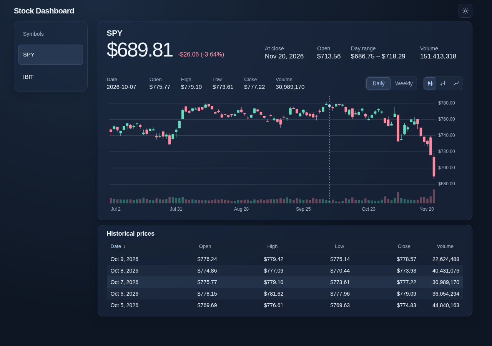

# Stock Dashboard

A React and TypeScript dashboard for exploring daily and weekly prices for SPY and IBIT. It uses D3 and SVG for interactive charts alongside a sortable price history.

**[Live demo](https://nlevick.github.io/stock-dashboard/)** · [Architecture](src/docs/ARCHITECTURE.md)



I built it as a small, rate-limited API dashboard. Sort and scroll the price history, then select a row to pin that date on the chart. The chart supports keyboard and touch inspection, and the dashboard shows loading and retry states.

## Run locally

Use Node.js 22.12 or later. The production build includes the same historical snapshot as the public demo and needs no API key.

```sh
npm ci
npm run build
npm run preview
```

To develop against Alpha Vantage, set `VITE_ALPHA_VANTAGE_KEY` in
`.env.development.local` and run `npm run dev`.
[Get an API key](https://www.alphavantage.co/support/api-key/)
